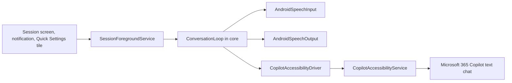

# Architecture

Copilot Voice Bridge keeps the Microsoft 365 Copilot **text** chat (and whatever model is selected there) and adds a hands-free voice loop on top. It never calls a Microsoft API. Android speech services and an accessibility service drive the official app the way a person would.

The split is deliberate: the conversation policy is pure Kotlin, and the phone-specific pieces sit behind interfaces. A later Windows build can reuse `:core` and replace the Android driver with UI Automation.

## Modules

| Module | Depends on | What lives here |
| --- | --- | --- |
| `:core` | nothing Android | Conversation loop, completion detector, markdown/citation sanitizer, selector matching, work-profile decision text |
| `:speech` | `:core` | `SpeechRecognizer` and `TextToSpeech` |
| `:automation` | `:core` | Accessibility service, node-tree dump, Copilot UI driver |
| `:app` | all three | Compose UI, foreground service, Quick Settings tile, DataStore and the selector JSON file |

`:core` has no `android.*` imports. That is the rule that keeps it reusable.

## One turn

1. The foreground service starts the loop.
2. The driver brings the configured package to the foreground.
3. Speech recognition listens until the utterance ends.
4. A stop phrase ("stop session" by default) ends the loop instead of sending.
5. The driver snapshots the visible message texts, writes the utterance into the chat box, and presses send.
6. It polls. `:core` decides which new text is the assistant reply and when that reply has finished streaming.
7. Markdown and citation markers are stripped. Text-to-speech speaks the result.
8. The loop listens again. While it is speaking, a tap or speech that is not an echo of the reply interrupts playback (barge-in).

## Where to change what

| You want to… | Edit |
| --- | --- |
| Point at a different Copilot package | Calibrate screen, or `targetPackage` in `core/src/main/resources/default_driver_config.json` |
| Tune view matching after a Copilot update | The same JSON: `selectors.chatInput`, `sendButton`, `generatingIndicator`, `assistantMessage`. No Kotlin change. The Calibrate dump shows the live tree. |
| Change how long a reply must sit still | `completion.stableForMs` and `completion.mode` in that JSON |
| Change the words that end a session | `stopPhrases` in that JSON |
| Ignore a footer such as an AI disclaimer | `messageTextExcludes` |
| Change markdown or citation stripping | `core/.../text/MarkdownSpeechSanitizer.kt` and its unit test |
| Change "the reply is finished" | `core/.../completion/ResponseCompletionDetector.kt` |
| Change which bubble counts as the new reply | `core/.../text/AssistantTextResolver.kt` |
| Change the listen / send / speak order | `core/.../loop/ConversationLoop.kt` |
| Change on-device speech recognition | `speech/.../AndroidSpeechInput.kt` |
| Change engines, voices, rate, pitch | `speech/.../AndroidSpeechOutput.kt` and the Voice screen |
| Change how text is inserted or send is pressed | `automation/.../CopilotAccessibilityDriver.kt` |
| Change the node-tree dump format | `formatDump` in that same file |
| Change work-profile / Intune messages | `core/.../access/AccessDecision.kt`. The Android probe that fills the facts is `automation/.../WorkProfileInspector.kt`. |
| Change the floating Listening / End chip | `automation/.../CopilotAccessibilityService.kt` |
| Change the notification or Quick Settings tile | `app/.../service/SessionForegroundService.kt`, `app/.../tile/SessionTileService.kt` |

Selector rules are data. `NodeSelectorMatcher` only interprets them:

- A selector matches if **any** rule matches.
- Inside one rule, every field that is set is **AND**.
- A non-empty contains/equals list matches if **any** entry hits.
- `notContains` fails the rule if any entry hits.
- `pick` chooses among the matches (`BOTTOM_MOST` is the usual choice for a chat composer).

Do not add a Copilot resource id in Kotlin. Put it in the JSON and ship a new default, or let the phone save an override in `files/driver_config.json`.

## Completion modes

`ResponseCompletionDetector` sees only the assistant text that `AssistantTextResolver` decided is new, plus a boolean for "generating indicator is on screen".

| Mode | Finishes when |
| --- | --- |
| `BOTH` (default) | Text unchanged for `stableForMs` **and** the indicator is not showing. If the indicator selector never matches, "not showing" is already true, so text stability alone finishes the turn. |
| `TEXT_STABLE` | Text unchanged for `stableForMs`. The indicator is ignored. |
| `INDICATOR_HIDDEN` | The indicator was seen and then disappeared. If it is never seen, falls back to text stability so a bad selector cannot hang the session. |
| `EITHER` | Text is stable, **or** the indicator disappears. |

Empty snapshots do not complete and do not reset the timer. A single blank frame while the list redraws will not throw away a reply that was already on screen.

## Work profile and Intune

`WorkProfileInspector` records whether the target package is installed for this user, whether another profile exposes it, and whether a window is on screen but has no readable tree. `AccessDecision` turns those facts into a message. The app stops the session when content is blocked. It does not try to cross a work-profile boundary or defeat an app-protection policy.

The supported setup when Copilot is a work app is to install **this** app inside that same work profile and enable the accessibility service there.

## Windows later

Implement `ChatDriver` with UI Automation. Map each element to `NodeSnapshot` and keep using `NodeSelectorMatcher`, `AssistantTextResolver`, `ResponseCompletionDetector`, `MarkdownSpeechSanitizer`, and `ConversationLoop`. Speech can be a Windows implementation of `SpeechInput` and `SpeechOutput`. None of those types mention Android.

## Build map

Versions live in `gradle/libs.versions.toml`. SDK levels are `minSdk` 29, `compileSdk` / `targetSdk` 35. `targetSdk` 35 runs on the Galaxy S25 Ultra's current One UI (Android 15 and newer) using the platform compatibility behavior for newer releases.
